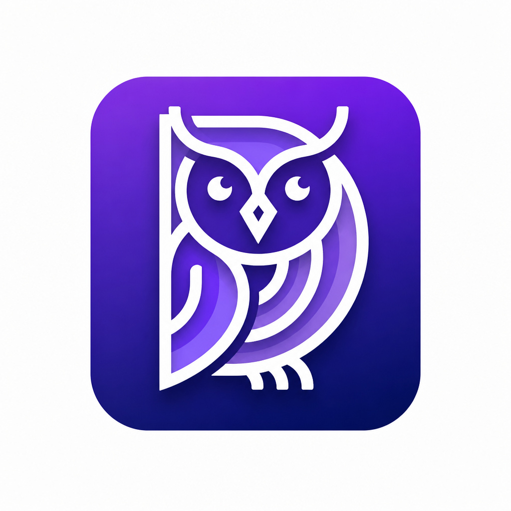

<p align="center"></p>

# DermaLens
**Android-Based Skin Disease Detection System Using YOLOv11 Algorithm.** DermaLens screens a photo of the skin for six common conditions (acne vulgaris, eczema, melasma, tinea, warts and scabies), entirely on the phone and without an internet connection, then helps the user track the spot over time and find a nearby dermatology clinic. It is a preliminary screening aid, not a diagnosis: every result tells the user to consult a dermatologist.

Capstone Project, BS Information Technology, College of Computer Studies, Tarlac State University, 2026.

> **Status:** final build **1.2.0** (Room schema v11). Capstone defense: October 27, 2026.

---

## Contents
- [Features](#features)
- [How a scan is decided](#how-a-scan-is-decided)
- [Results](#results)
- [Tech Stack](#tech-stack)
- [Project Structure](#project-structure)
- [Building & Running](#building--running)
- [Firebase Auth](#firebase-auth)
- [Cloud Firestore](#cloud-firestore)
- [Contribute to Research pipeline](#contribute-to-research-pipeline)
- [AI Model — Training & Evaluation](#ai-model--training--evaluation)
- [Security](#security)
- [Known Limitations](#known-limitations)
- [Known Gaps / Good First Issues](#known-gaps--good-first-issues)
- [Development Timeline](#development-timeline)
- [Team](#team)

## Features
- **Skin Scan** — Capture with the camera (pinch-to-zoom) or pick from the gallery (pan + pinch-to-zoom to position). The photo is cropped to the guide frame and re-encoded before analysis, which also strips EXIF metadata such as GPS location. On-device YOLOv11 inference returns the condition, a confidence score and real bounding boxes (multi-region, NMS-filtered) drawn on the result image.
- **Honest results** — A condition is named only at 30% confidence or higher. Below that the app shows "No Clear Condition Detected" with retake tips, "No Condition Found" for clear skin, or "Image Too Unclear" for a blank or dark photo (see [How a scan is decided](#how-a-scan-is-decided)). **Other Possibilities** lists up to two look-alike conditions.
- **Condition information** — Description, common symptoms, possible causes (with sources), and a recommendation to consult a dermatologist, shown on the result screen. Treatment advice was removed on the validating experts' advice.
- **Family Tree** — Subtype and look-alike reference screens for each condition, reached from the result's "Related Conditions" card.
- **Progress Tracker** — Saved scans grouped into per-spot timelines by condition. Every scan keeps its photo, its bounding boxes and an editable note, and tapping an entry reopens the saved result (not a fresh re-inference). "Scan Again" continues the same timeline.
- **Clinic Locator** — Google Map of nearby dermatology clinics (Google Places API) with hours, driving routes and travel time (Google Routes API), and crowd-sourced "still open / closed" votes stored in Cloud Firestore.
- **Scan reminders** — Daily reminder at a time the user picks (WorkManager).
- **Scan history backup** — Optional, off by default: backs up scan records (never photos) to Cloud Firestore, readable only by the account's owner.
- **Contribute to Research** — Opt-in, per-scan consent; anonymous photo uploads over Wi-Fi only (see [the pipeline](#contribute-to-research-pipeline)).
- **Accounts** — Firebase email/password registration with enforced email verification, or **Sign in with Google**. Edit Profile, Change Password, Forgot Password, and Delete Account (reauthenticates, withdraws the account's clinic votes, deletes local scans and photos and the Firebase account). The app never guesses a user's name from their email; Home asks "How should we call you?" instead.
- **Accessibility** — Font size slider and high-contrast mode, applied across all screens.
- **Privacy** — In-app Privacy Policy and liability disclaimer; research consent prompt for new accounts.

## How a scan is decided
The model has no "healthy" class. After inference, `ml/YoloDetector.kt` turns the highest class score into one of these results (Table 16 of the paper):

| Situation | Result shown |
|---|---|
| Photo is blank, covered or too dark (luminance standard deviation < 10) | **Image Too Unclear** — the model is not run |
| Top score < 10% **and** ≥ 70% of the photo is skin-coloured (YCrCb rule) | **No Condition Found** |
| Top score < 30% (any other case) | **No Clear Condition Detected** — retake tips |
| Top score ≥ 30% | **Condition detected** — box, score, information, consult advice |
| Another class ≥ 15% | Listed under **Other Possibilities** (up to two) |

The 30% floor sits above the model's F1-optimal 24.7% because non-skin textures scored up to 26.9% in live testing. The model was also fine-tuned with photos that contain no condition (clear skin close-ups and outdoor scenes), so clear skin scores low.

## Results
Evaluation results from the capstone paper (Chapter 5):

| Test | Result |
|---|---|
| Functional testing (manual black-box) | **26 / 26** test cases passed (100%), 3 testers |
| Performance (Realme 8, Helio G95, 8 GB RAM, Android 13) | All 9 thresholds passed: 1.985 s cold start, 0 slow or frozen frames, 0 crashes and 0 ANRs in 30 min, 0.47 GB peak memory, 150.29 MB download |
| Detection accuracy (3 licensed skin health experts, 90 entries) | **94.37%** sensitivity, precision and F1-score; **91.11%** accuracy |
| Interaction capability (ISO/IEC 25010:2023, 96 end-users) | **4.546** — Strongly Agree |
| Functional suitability (ISO/IEC 25010:2023, 3 IT practitioners) | **4.509** — Strongly Agree |

Detection accuracy by condition:

| Condition | Sensitivity | Precision | F1 | Accuracy |
|---|---|---|---|---|
| Acne Vulgaris | 86.67% | 100.00% | 92.86% | 88.89% |
| Eczema | 100.00% | 90.00% | 94.74% | 91.67% |
| Melasma | 100.00% | 100.00% | 100.00% | 100.00% |
| Tinea | 86.67% | 100.00% | 92.86% | 88.89% |
| Warts | 100.00% | 100.00% | 100.00% | 100.00% |
| Scabies | 100.00% | 70.00% | 82.35% | 75.00% |

Each condition had only six entries per expert, so these results should be read with caution.

## Tech Stack
| Layer | Technology |
|---|---|
| Language / UI | Kotlin 2.0.21, Jetpack Compose + Material 3 |
| Navigation | Navigation Compose |
| Database | Room (SQLite), normalized to 3NF: `users`, `track_groups`, `scan_records`, `bounding_boxes` with cascading foreign keys |
| Camera | CameraX (`PreviewView.ImplementationMode.COMPATIBLE`) |
| Gallery | `ActivityResultContracts.PickVisualMedia` |
| Image loading | Coil (`AsyncImage`) |
| AI model | YOLOv11-medium (`yolo11m`), TensorFlow Lite, full FP32 precision, bundled in the APK |
| Maps | Google Maps SDK (`maps-compose`), Places API (clinic search), Routes API (directions) |
| Location | `play-services-location` |
| Auth | Firebase Authentication (email/password, and Google via `androidx.credentials`) |
| Cloud data | Cloud Firestore — clinic votes and opt-in scan backup (`firestore.rules`) |
| Background work | WorkManager — reminders and research uploads |
| Research uploads | Google Apps Script Web App → project owner's Google Drive |
| Model training | Google Colab (T4/L4 GPU), Ultralytics YOLOv11, Roboflow (annotation and augmentation) |

## Project Structure
```
app/src/main/java/
├── com/dermalens/app/
│   ├── data/
│   │   ├── db/          # DermaDatabase (migrations 7→11), DAOs
│   │   ├── model/       # User, TrackGroup, ScanRecord, BoundingBox entities
│   │   └── sync/        # ScanHistorySync — opt-in Firestore backup
│   ├── ml/
│   │   └── YoloDetector.kt   # TFLite inference, NMS, CLASS_LABELS, result thresholds
│   ├── navigation/      # NavGraph, Screen sealed class
│   └── ui/
│       ├── screens/
│       │   ├── Screens.kt               # Login, Register, Verify Email, Privacy Policy
│       │   ├── OnboardingScreen.kt
│       │   ├── HomeScreen.kt            # Home + bottom nav bar
│       │   ├── CameraScreen.kt          # Camera + gallery, crop to guide frame
│       │   ├── ScanResultScreen.kt      # Result, condition content, save
│       │   ├── ConditionSources.kt      # Cited sources for condition content
│       │   ├── FamilyTree.kt / FamilyTreeScreen.kt
│       │   ├── ProgressTrackerScreen.kt
│       │   ├── ClinicLocatorScreen.kt
│       │   ├── ClinicVotes.kt           # Firestore open/closed votes
│       │   └── ProfileScreen.kt         # Profile, Edit Profile, settings, Delete Account
│       ├── theme/
│       ├── AppSettings.kt    # Font scale + high contrast state
│       └── DermaColors.kt    # Colors, DermaPrefs, animation helpers
└── worker/              # (package com.dermalens.app.worker — flat dir is intentional)
    ├── ScanReminderWorker.kt
    ├── ContributionUploadWorker.kt   # Research upload, Wi-Fi only
    └── NotificationScheduler.kt      # + ContributionUploadScheduler

app/schemas/             # Exported Room schemas (one JSON per DB version)
firestore.rules          # Firestore security rules (publish via the Firebase console)
apps-script/ContributionUpload.gs   # The Drive upload endpoint (deploy as a Web App)
```

Training notebooks live in `training/` (`merge_and_train_multiclass.ipynb`, `finetune_v2_background.ipynb` and others). They are **gitignored** because they carry pasted Roboflow API keys; ask a team member for a copy.

## Building & Running
Requirements: Android Studio, JDK 17, a device or emulator on **Android 8.0 (API 26)** or higher.

1. Clone the repo and open it in Android Studio. Let Gradle sync finish.
2. Add the files that are **not** in the repo:
   - `app/google-services.json` — from the Firebase project (ask Mark Joseph, or download it from the Firebase Console).
   - `app/src/main/assets/best.tflite` — the 80.5 MB model. Without it, a build falls back to random mock results.
   - `local.properties` entries: `MAPS_API_KEY`, `APPS_SCRIPT_URL`, `CONTRIBUTION_UPLOAD_SECRET`, `GOOGLE_WEB_CLIENT_ID`. They are read into `BuildConfig`; **never commit them** (this repo is public).
3. Run on a device or emulator.

To build an installable **release APK** (the demo build), see "Building an installable release APK" in [docs/HANDOFF.md](docs/HANDOFF.md). It needs signing flags because `build.gradle.kts` has no release signing config.

> VS Code shows "Unresolved reference" errors on Compose/Room imports. They are not real and go away after a Gradle sync in Android Studio.

Full onboarding steps are in [SETUP.md](SETUP.md); developer notes and history are in [docs/HANDOFF.md](docs/HANDOFF.md).

## Firebase Auth
Accounts go through real Firebase Authentication: a new account is a real, Console-visible user, gets a real verification email, and password reset uses Firebase's "Forgot password?" email flow. Registration is required; there is no guest path (removed on 2026-08-25 at the tech adviser's request — see `docs/FIREBASE_AUTH_PLAN.md`). Scan history and profile data stay local in Room unless the user turns on the backup.

- **Email verification is enforced.** An unverified account is routed to "Verify Your Email" (Resend / Log Out) instead of Home, on Register and on every Login, until Firebase reports `isEmailVerified == true`.
- **Password policy is enforced server-side.** Register and Change Password check 8+ characters with upper, lower, number and special locally, and the same policy is set in **Firebase Console → Authentication → Settings → Password policy** (enforcement mode **Require**), so Firebase's hosted reset page enforces it too.
- **Sign in with Google** covers both login and first-time signup. It only works when the APK's signing certificate SHA-1 is registered in Firebase. Delete Account and Change Password detect Google-only accounts and reauthenticate with a fresh Google credential.

## Cloud Firestore
Firestore holds only two things, and [firestore.rules](firestore.rules) denies everything else:

1. **Clinic votes** — `clinic_status/{placeId}` counts plus each user's own vote. The counts are written by the client (no Cloud Functions, to stay on the free Spark plan), so the rules check that every count change exactly matches the caller's own vote change in the same transaction. Each account also keeps `users/{uid}/clinicVotes` so Delete Account can withdraw its votes.
2. **Opt-in scan backup** — `users/{uid}/scans/{scanDate}`: condition, confidence, notes and group, never photos. Readable and writable only by the owner, shape-checked, and writes need a verified email.

**When you change the rules file, publish it**: Firebase Console → Firestore Database → Rules → paste the file → Publish. The app does not deploy rules itself, and synced-field changes in the app need a matching rules change.

## Contribute to Research pipeline
Consented scans genuinely leave the device. End to end:

1. The user enables the feature once (Profile → Contribute to Research). This only controls whether the per-scan prompt appears; it uploads nothing by itself.
2. After **Save to Progress**, if the feature is on, a yes/no dialog asks whether to contribute *this* scan. Only "Yes" flags the row `contributedForTraining`.
3. A WorkManager job (`ContributionUploadWorker`, `NetworkType.UNMETERED`, about every 12 hours, plus an immediate attempt after "Yes") POSTs pending images to a **Google Apps Script Web App**, which files each one into `DermaLens Contributions/<condition>/` in the script owner's Google Drive. The row is then flagged `uploadedForTraining` so nothing uploads twice.

**Why Apps Script and not Firebase Storage:** Cloud Storage now requires the Blaze plan, and Blaze wanted a prepayment we didn't want to spend on a student project. Apps Script runs under the owner's Google account with no billing, and only a low-value shared secret ships in the APK because the script itself holds the Drive permissions.

**Privacy properties:**
- The request holds only the image, a random-UUID filename and the detected condition. No user ID, email or device ID.
- Photos are re-encoded when cropped, so no EXIF metadata (GPS location, device model) is uploaded.
- Contributions land in shared per-condition folders, not per-user folders.
- Wi-Fi only; standard HTTPS plus the shared secret. The secret is access control, not full authentication, since it can be extracted from the APK.

**Setup** (once, by whoever owns the receiving Drive): deploy `apps-script/ContributionUpload.gs` as a Web App (Execute as: Me, Who has access: Anyone), set a `SHARED_SECRET` script property, then put the `/exec` URL and the same secret into `local.properties` as `APPS_SCRIPT_URL` and `CONTRIBUTION_UPLOAD_SECRET`. Step-by-step is in the `.gs` file's header. If `APPS_SCRIPT_URL` is blank, the worker exits cleanly as a no-op.

## AI Model — Training & Evaluation
**Current model:** YOLOv11-medium, TFLite FP32 (80.5 MB). The six conditions were first trained together as one merged model (v2, validation mAP50 0.654), then **fine-tuned with 491 "nothing here" background photos** (2026-10-02) to cut false detections. Training images come from public Kaggle and Roboflow datasets, cleaned, annotated and augmented in Roboflow. On 392 held-out test photos, using the app's own decision logic, accuracy went from 82.7% to **89.5%**, and false alarms on unseen non-skin scenes dropped from 31.4% to **1.4%**. Known limit: clinical-style scabies (inflamed, infant soles and palms; infants are outside the app's scope) still tends to read as Eczema. Full breakdown in `docs/HANDOFF.md`.

v2's box-level results, before the fine-tune:

| Condition | v2 AP50 | Solo baseline |
|---|---|---|
| Tinea | 0.828 | ~0.86–0.90 (near parity) |
| Scabies | 0.698 | 0.701 (near parity) |
| Eczema | 0.674 | 0.735 |
| Warts | 0.658 | ~0.6+ (at/above parity) |
| Melasma | 0.569 | 0.696 — **didn't move between v1 and v2, still an open item** |
| Acne Vulgaris | 0.499 | 0.536 |

- **`CLASS_LABELS` in `ml/YoloDetector.kt` must match the training class order exactly** — the merge notebook prints the exact line to paste. See `docs/HANDOFF.md`.
- Auto-detects channels-first `[1,3,H,W]` vs. channels-last `[1,H,W,3]` tensor layout at runtime, and expects a plain stretch-to-square resize (not letterboxing), matching Roboflow's "Resize: Stretch" preprocessing.
- Confidence percentages vary photo to photo even for correct detections; mAP is the aggregate measure, a single scan's percentage is not.
- **Scanning tip:** don't over-zoom. A tight crop on a single lesion measurably *lowered* confidence (28.6% → 17.4% on the same wart photo), because training images show the lesion with surrounding skin.

<details>
<summary><b>How we got here (model history)</b></summary>

- **Early solo runs.** Single-class sanity checks. One (Melasma) exported to TFLite and confirmed real on-device inference at 77.7% confidence — this surfaced the channels-first layout and stretch-to-square requirements noted above.
- **Bounding-box bug found & fixed.** The inference code was discarding box coordinates and keeping a single best box. Fixed to extract all real boxes with confidence thresholding + NMS — verified live on a bilateral melasma photo (two separate boxes, one per cheek).
- **v1 merge (superseded).** First 6-class merge: overall mAP50 0.557, every class below its solo model, and a real acne photo scored as Scabies at 52.3%. Root cause: Acne averages ~12 boxes per image vs. Tinea/Melasma's ~1, so Acne dominated training by instance count (20,528 vs. Tinea's 1,736) even with images balanced.
- **Preprocessing mismatch, fixed.** Two source datasets (Melasma, Scabies) used Roboflow's "Fit within" (letterbox) resize while the others used "Stretch to". Fixing both moved Scabies 0.297→0.360 and Melasma 0.572→0.602.
- **Scabies annotation issue, identified.** 34% of scabies source images had a single whole-image box over photos with 6–15 lesions. 114 affected images are identified and still pending re-annotation.
- **v2 fix: instance-aware oversampling.** A second balancing pass tops up under-represented classes by box-instance count. Result: overall mAP50 0.654, and the v1 cross-condition misfire is gone (0.09 off-diagonal ceiling).
- **Model size:** `yolo11m` scored 0.696 vs. `yolo11s`'s 0.602 on the same Melasma data, so the merge uses `yolo11m`. A more heavily augmented Acne dataset scored statistically identical (0.534 vs. 0.536) — Acne's ceiling looks like an inherent small-numerous-lesion difficulty. A 5-class acne subtype model scored only 0.234 mAP50, so subtypes are parked — see `training/acne_subtypes_future/README.md`.
- **Background fine-tune (2026-10-02).** Fine-tuned v2 on 491 photos with no labels (outdoor scenes plus faces and skin close-ups), which taught the model that clear skin and non-skin scenes contain nothing to detect. A second round that swapped in a new scabies dataset made results worse (84.5% → 79.2%) and was not shipped.

</details>

## Security
Reviewed against the OWASP MASVS categories; see [docs/SECURITY_TESTING.md](docs/SECURITY_TESTING.md). No high-severity issues are open. Re-checked on 2026-10-22:
- HTTPS only (`usesCleartextTraffic="false"`); only the launcher activity is exported; no WebViews.
- The Room database and scan photos are excluded from Android backup and device transfer.
- The Maps API key is restricted to the app's package and signing certificate — a request from outside the app is rejected (`API_KEY_ANDROID_APP_BLOCKED`).
- The research upload endpoint rejects requests with a wrong secret.
- Firestore rules: owner-only backup, verified email for writes, vote counts that can't be forged.

Known, accepted limits: the upload secret can be extracted from the APK (someone could send junk images to the Drive folder, but no user data is exposed), and local data relies on Android's app sandbox rather than encryption.

## Known Limitations
- **Six conditions only.** Rare, untrained or complex conditions are not recognized, and the app is not meant for infants.
- **Skin tone coverage.** About 67% of training images show light skin and about 10% dark skin, so accuracy may vary on darker skin.
- **Scabies on clinical-style photos** often reads as Eczema; the validating expert noted scabies is hard to confirm visually without patient history.
- **Fresh clones have no model.** `best.tflite` is gitignored; without it, results are random mock data.
- **Online-only features.** Accounts, the clinic locator, backup and research uploads need the internet; scanning, results and progress work offline once logged in.
- **Android only.**

## Known Gaps / Good First Issues
- **Email change isn't implemented.** The email field in Edit Profile is read-only; Firebase needs a `verifyBeforeUpdateEmail()` flow (see `docs/FIREBASE_AUTH_PLAN.md`).
- **Firebase BoM is pinned to `33.5.1`** because newer BoMs need Kotlin 2.3.0 and this project is on Kotlin 2.0.21. Bump Kotlin first or the build breaks.
- **The Places/Routes certificate SHA-1 is hardcoded** (`ANDROID_CERT_SHA1` in `ClinicLocatorScreen.kt`). It's one specific debug keystore's SHA-1, so clinic search returns nothing for builds signed with another key. Add your SHA-1 to the restricted key in Google Cloud Console and update the constant, or read it at runtime from the app's signing info.
- **No release signing config.** Release builds are signed with the debug keystore via command-line flags (see `docs/HANDOFF.md`). A real release key needs its SHA-1 added to Firebase and Google Cloud.
- **No over-the-air model updates.** A new model needs a full app update.
- **No formal accessibility audit** (WCAG contrast ratios, TalkBack).
- **Scabies re-annotation** — 114 images need per-lesion boxes.

## Development Timeline
Agile-Scrum, May – October 2026 (Table 31 of the paper):

| Phase | Dates | Focus |
|---|---|---|
| Planning | May 1 – 8 | Scope, product backlog, technical approach |
| Sprint 1 | May 9 – 28 | App prototype and core screens |
| Sprint 2 | June 1 – 30 | Dataset collection and annotation |
| Sprint 3 | July 1 – 31 | YOLOv11 model training |
| Sprint 4 | August 1 – 31 | TFLite conversion, on-device inference, Firebase Authentication |
| Sprint 5 | September 1 – 17 | Six-condition model, clinic locator, remaining features |
| Sprint 6 | September 18 – October 1 | Testing, evaluation, late features |
| Sprint 7 | October 2 – 16 | Model fine-tuning, redesign, final build |

Testing and evaluation: functional suitability (Sep 18), interaction capability (Sep 29 – Oct 1), functional and performance testing (Sep 30), expert detection accuracy (Oct 4 – 8).

## Team
- Mark Joseph C. Garcia
- Reynaldo D. Manio Jr.
- Reicee Owen P. Pastrana
- Chrisent Dayniel P. Tolentino

Technical adviser: Ma'am Heidilyn Gamido

*College of Computer Studies, Tarlac State University — Capstone 2026*
